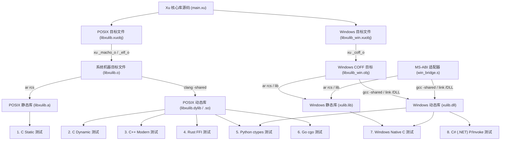

# Xu 编译导出为动态库与静态库及多语言全类型互操作实战

本示例完整展示如何使用 **Xu 语言编写底层核心库**，通过 Xu 原生编译器将其构建为**静态库 (`libxulib.a` / `xulib.lib`)** 与**动态库 (`libxulib.dylib` / `libxulib.so` / `xulib.dll`)**，并在 **C、C++、Rust、Python、Go、C# (.NET)** 等主流宿主语言中进行跨语言调用（FFI / P-Invoke / cgo / ctypes），全面覆盖并测试 Xu 语言支持的**全部 14 种核心数据类型与内存规约**，全面支持 **macOS、Linux 与 Windows**。

> [!NOTE]
> 本示例是 `19_native_c`（Xu 调用 C 原生库）的对偶示范：展示**以 Xu 作为基础库的提供方**，供各种外部宿主语言调用的完整工具链流水线、物理 ABI 规约与多语言工程实践。

---

## 1. 覆盖测试的全部数据类型与 ABI 规约

Xu 编译器在 AOT 编译时将公开函数 (`pub fn`) 符号导出为全局符号。各类型的物理寄存器与内存布局映射如下：

| 序号 | 数据类型分类 | Xu 类型标识 | C / C++ 对应声明 | Python ctypes | Rust FFI | Go cgo | C# (.NET) P/Invoke | ABI 物理布局与传递规范 |
|:---:|:---|:---|:---|:---|:---|:---|:---|:---|
| 1 | **标量整型 (64位)** | `int` | `int64_t` | `c_int64` | `i64` | `C.int64_t` | `long` | 64 位有符号整数，寄存器传参，通用寄存器返回。 |
| 2 | **标量整型 (32位)** | `i32` | `int32_t` | `c_int32` | `i32` | `C.int64_t` | `int` | 32 位有符号整数。在 64 位调用约定下由调用方保证高 32 位符号扩展。 |
| 3 | **无符号整型 (32位)** | `u32` | `uint32_t` | `c_uint32` | `u32` | `C.uint32_t` | `uint` | 32 位无符号整数，循环位移（rotate）、位掩码等支持。 |
| 4 | **单字节整型 (8位)** | `u8` / `byte` | `uint8_t` | `c_uint8` | `u8` | `C.uint8_t` | `byte` | 8 位无符号单字节整数，位掩码与字节运算。 |
| 5 | **布尔类型** | `bool` | `uint8_t` / `bool` | `c_bool` | `u8` / `bool` | `uint8` | `byte` / `bool` | 布尔真假逻辑（`1 = true`, `0 = false`）。 |
| 6 | **双精度浮点** | `f64` | `double` (u64位模式) | `c_uint64` (位模式) | `f64` (u64位模式) | `C.double` | `double` (u64位模式) | 64 位 IEEE-754 双精度浮点。按通用寄存器位模式传递。 |
| 7 | **UTF-8 字符串** | `string` | `XuString` 描述符 | `XuStringDesc` | `XuString` | `*C.char` (helper) | `XuString` 描述符 | 3 槽降序描述符：`offset 0: ptr`, `offset -8: len`, `offset -16: cap` (0=只读常量)。返回值通过 sret 缓冲区接收。支持求长、统计、下标字节访问、打印、函数返回与拼接。 |
| 8 | **结构体 (传参/返回/混合)** | `struct` | `XuPoint2D` / `XuMixedRecord` | `XuPoint2D` / `XuMixedRecord` | `XuPoint2D` / `XuMixedRecord` | `C.XuPoint2D` | `XuPoint2D` / `XuMixedRecord` | 结构体降序内存布局：字段 0 位于 Top Slot `[ptr]`, 后续字段依次 `-8`。返回值通过 sret 缓冲区接收。 |
| 9 | **动态切片** | `[]int`, `[]u8`, `[]f64` | `XuSliceInt`, `XuSliceByte`, `XuSliceF64` | `XuSliceDesc` | `XuSlice` | `C.xu_sum_slice`, ... | `XuSlice` 描述符 | 动态数组切片视图。与 string 共享 3 槽描述符：`offset 0: ptr`, `offset -8: len`, `offset -16: cap` (0=只读借用)。 |
| 10 | **定长数组** | `[4]int` | `XuFixedArray4` | `XuFixedArray4` | `XuFixedArray4` | `C.xu_sum_fixed_array` | `XuFixedArray4` | 固定长度数组。连续内存降序排列，首元素位于 Top Slot `[ptr]`，末元素位于 `[ptr - 24]`。 |
| 11 | **代数枚举** | `enum Status` | `int64_t*` (tag 指针) | `POINTER(c_int64)` | `*const i64` | `*C.int64_t` | `ref long` | 变体标签值（`0=Ok, 1=Pending, 2=Failed`），按引用传递指针以支持模式匹配。 |
| 12 | **可变引用 (原地修改)** | `&mut Counter` | `XuCounter*` (指针传参) | `POINTER(XuCounter)` | `*mut i64` | `*C.XuCounter` | `ref long` | 底层指针直接寻址，修改调用方内存中的结构体/数据字段。 |
| 13 | **闭包 / 回调函数** | `fn(int, int) int` | `XuClosure` 闭包描述符 | `XuClosureDesc` | `XuClosure` | `invoke_xu_callback` | `XuClosure` / `delegate` | 闭包描述符：`offset 0: fn_ptr`, `offset -8: env`。调用时传入 `env` 及常规参数。 |
| 14 | **空类型过程** | `void` | `void` | `None` | `()` | `void` | `void` | 无返回值副作用过程（打印输出、状态机等）。 |

---

## 2. 复合类型内存布局与 ABI 深度解析

### 2.1 字符串类型 (`string`) 与 切片类型 (`[]T`)
Xu 采用高性能降序描述符模型：
```text
    高地址
    ┌──────────────────────┐  <-- 传给函数的指针 (Top Slot: &ptr)
    │ ptr: const void*     │  数据缓冲区实际内存地址 (UTF-8 字符、int64 数组、u8 字节或 f64 浮点数)
    ├──────────────────────┤
    │ len: int64_t         │  元素个数 / 字节长度
    ├──────────────────────┤
    │ cap: int64_t         │  容量标志：
    └──────────────────────┘    cap == 0: 只读常量视图 (借用，Xu 退出时不释放)
    低地址                      cap >  0: 堆分配拥有内存 (Xu runtime 负责析构)
```

### 2.2 结构体 (`struct Point2D` 与 `struct MixedRecord`)
Xu 对结构体成员采用确定性降序分布：
```text
    高地址
    ┌───────────────────────────┐  <-- 结构体指针 (Top Slot: &rec.id)
    │ Field 0 (id): int64_t     │  [ptr]
    ├───────────────────────────┤
    │ Field 1 (score): uint64_t │  [ptr - 8]  (IEEE-754 浮点二进制位模式)
    ├───────────────────────────┤
    │ Field 2 (flag): uint64_t  │  [ptr - 16] (布尔值 1 / 0)
    └───────────────────────────┘
    低地址
```

### 2.3 定长数组 (`[4]int`)
定长数组在物理上同样采用自顶向下降序布局：
```text
    高地址
    ┌───────────────────────────┐  <-- 数组指针 (Top Slot: &arr.e0)
    │ Element 0 (arr[0]): int64 │  [ptr]
    ├───────────────────────────┤
    │ Element 1 (arr[1]): int64 │  [ptr - 8]
    ├───────────────────────────┤
    │ Element 2 (arr[2]): int64 │  [ptr - 16]
    ├───────────────────────────┤
    │ Element 3 (arr[3]): int64 │  [ptr - 24]
    └───────────────────────────┘
    低地址
```

### 2.4 回调函数闭包 (`fn(int, int) int`)
Xu 闭包调用协议通过 2 个机器字传递：
```text
    高地址
    ┌──────────────────────┐  <-- 闭包指针 (Top Slot: &c.fn_ptr)
    │ fn_ptr: void*        │  函数指针入口地址
    ├──────────────────────┤
    │ env: void*           │  捕获环境变量 (无捕获时传 NULL)
    └──────────────────────┘
    低地址
```

---

## 3. 架构与编译流水线



---

## 4. 文件结构与职责清单

```text
examples/examples/20_c_export_lib/
├── xu.xun                 # 包声明与编译器版本约束
├── main.xu                # Xu 核心库实现 (导出全部 14 种数据类型函数) + 独立 self-test
├── xulib.h                # C/C++ 通用头文件 (符号声明、结构体布局与便利内联函数)
├── xulib.def              # Windows DEF 模块定义文件 (规范导出别名映射)
├── win_bridge.s           # Windows x64 MS-ABI 到 Xu ABI 的非易失性寄存器自适应桥接
├── test_dynamic.c         # C 语言动态链接测试 (POSIX)
├── test_static.c          # C 语言静态链接测试 (POSIX)
├── test_cpp.cpp           # C++ 测试 (集成 STL vector, string, cmath)
├── test_rust.rs           # Rust 强类型 FFI 测试
├── test_python.py         # Python 动态加载 ctypes 测试 (跨 macOS / Linux / Windows)
├── test_go.go             # Go cgo 桥接测试
├── test_windows.c         # Windows 原生 C 宿主测试 (支持静态链接与动态链接)
├── test_csharp.cs         # Windows C# / .NET P/Invoke 全类型调用测试
├── build_and_test.sh      # 自动化端到端构建与多语言全量验证脚本 (含 Windows 交叉编译)
├── build_and_test.bat     # Windows CMD 一键构建与测试批处理脚本
├── build_and_test.ps1     # Windows PowerShell 一键构建与测试脚本
├── Makefile               # 构建与清理规则 (含 win-lib 与 win-test 目标)
└── README.md              # 完整开发与互操作文档
```

---

## 5. 快速运行与测试 (macOS / Linux)

### 运行一键测试脚本（执行全部编译并测试所有语言）
```bash
./build_and_test.sh
```

### 使用 Makefile 分项测试
```bash
# 构建并运行全部宿主语言的所有测试
make all

# 构建 Windows 静态库 (xulib.lib) 与动态库 (xulib.dll)
make win-lib

# 构建 Windows 测试程序 (test_windows_dynamic.exe, test_windows_static.exe)
make win-test

# 仅测试 C 语言 (动态库 + 静态库)
make test-c

# 仅测试 C++
make test-cpp

# 仅测试 Rust
make test-rust

# 仅测试 Python
make test-python

# 仅测试 Go
make test-go

# 清理所有编译中间文件与可执行程序
make clean
```

---

## 6. Windows 原生环境与跨平台编译指南

针对 Windows 平台的开发者与生产部署，本库提供了全套原生支持方案：

### 6.1 Windows 库构件说明
- **静态库 (`xulib.lib`)**：通过 `xu build --target windows-x64 --emit-obj` 生成，由 `xu _coff_o` 转换为标准的 `PE-COFF (Intel amd64)` 目标，结合 `win_bridge.obj` 封装为静态库归档，可供 MSVC (`link.exe`) 或 MinGW (`gcc`) 静态链接。
- **动态库 (`xulib.dll` & `libxulib_dll.a`)**：包含标准 PE32+ 导出表，通过 `win_bridge.s` 内置了 Microsoft x64 Calling Convention（`RCX`, `RDX`, `R8`, `R9` 传参，保护 `RDI`/`RSI` 非易失性寄存器）到 Xu 调用的桥接适配，使任何标准的 Windows 调用方（C# P/Invoke、Python ctypes、MSVC C/C++）均可无需额外汇编直接平滑调用。

### 6.2 在 Windows 本机上一键构建与测试

#### 方式一：使用 CMD 批处理脚本
```cmd
cd examples\examples\20_c_export_lib
build_and_test.bat
```

#### 方式二：使用 PowerShell 脚本
```powershell
cd examples\examples\20_c_export_lib
.\build_and_test.ps1
```

### 6.3 在 Windows 下调用各语言测试

#### 1. Windows 原生 C 语言宿主 (`test_windows.c`)
- **动态链接 `xulib.dll`**：
  ```cmd
  gcc test_windows.c -L. -lxulib_dll -o test_windows_dynamic.exe
  test_windows_dynamic.exe
  ```
- **静态链接 `xulib.lib`**：
  ```cmd
  gcc test_windows.c xulib.lib -o test_windows_static.exe
  test_windows_static.exe
  ```

#### 2. C# / .NET P/Invoke 宿主 (`test_csharp.cs`)
```cmd
csc /nologo /out:test_csharp.exe test_csharp.cs
test_csharp.exe
```

#### 3. Python ctypes 宿主 (`test_python.py`)
```cmd
python test_python.py
```
`test_python.py` 已内置 Windows 平台自适应逻辑，自动加载当前目录下的 `xulib.dll`。

---

## 7. 测试结果输出

全部宿主语言、14 类数据类型测试全部通过：

```text
====================================================================
   Building Xu Library into Static (.a/.lib) & Dynamic (.dylib/.so/.dll)
   and Running Multi-Language, Multi-Type Verification Tests
   Callers: C (Dynamic & Static), C++, Rust, Python, Go, C# (.NET)
====================================================================

[Step 1/9] Using Xu Compiler: .../xu/bin/xu
[Step 2/9] Running Xu Standalone Self-Test (xu run main.xu)...
=== All Xu Self-Tests Completed Successfully ===

[Step 3/9] Compiling main.xu -> libxulib.xuobj -> libxulib.o...
[Step 4/9] Packaging static library (libxulib.a) and dynamic library (libxulib.dylib)...

[Step 5/9] Compiling and running C tests...
   >>> ALL DYNAMIC LIBRARY ASSERTIONS PASSED SUCCESSFULLY! <<<
   >>> ALL STATIC LIBRARY ASSERTIONS PASSED SUCCESSFULLY! <<<

[Step 6/9] Compiling and running C++ tests...
   >>> ALL C++ CALLER ASSERTIONS PASSED SUCCESSFULLY! <<<

[Step 7/9] Compiling and running Rust FFI tests...
   >>> ALL RUST FFI ASSERTIONS PASSED SUCCESSFULLY! <<<

[Step 8/9] Running Python ctypes and Go cgo tests...
  --> Running test_python.py...
   >>> ALL PYTHON CTYPES ASSERTIONS PASSED SUCCESSFULLY! <<<
  --> Compiling and running Go (cgo) test...
   >>> ALL GO (CGO) ASSERTIONS PASSED SUCCESSFULLY! <<<

[Step 9/9] Checking Windows cross-compilation toolchain...
  --> MinGW toolchain detected (x86_64-w64-mingw32-gcc). Cross-compiling Windows artifacts...
  --> Windows Artifacts Generated:
      - xulib.lib (Windows Static Library, PE-COFF archive)
      - xulib.dll (Windows Dynamic Library, PE32+ executable)
      - test_windows_dynamic.exe (Windows C Dynamic Caller)
      - test_windows_static.exe (Windows C Static Caller)
  >>> Windows PE32+ static library (xulib.lib), DLL (xulib.dll), and test EXEs verified!

====================================================================
   >>> SUCCESS: ALL TESTS PASSED ACROSS ALL HOST PLATFORMS! <<<
   Languages Verified: C (Dynamic + Static), C++, Rust, Python, Go, C#
   Windows Verified:   Static (xulib.lib), Dynamic (xulib.dll), C# (P/Invoke)
   Data Types Verified (14 Categories):
     1. int (64-bit)        2. i32 (32-bit)        3. u32 (unsigned)
     4. u8 (byte)           5. bool (logic)        6. f64 (IEEE float)
     7. string (UTF-8)      8. struct (arg/return) 9. slice ([]T views)
    10. array ([4]int)     11. enum (variants)    12. &mut (pointer in-place)
    13. callback (closure) 14. void (procedure)
====================================================================
```

## Windows x64 实际运行验证

使用 LLVM-MinGW 的 x64 C 编译器和归档器运行 `build_and_test.ps1`；ARM64 Windows 可通过系统 x64 仿真运行调用端。可用 `-Compiler`、`-Cc`、`-Ar`、`-Python`、`-Csc` 指定工具的完整路径。Python 必须与 DLL 同为 x64；未安装的可选宿主会明确打印 SKIP。

脚本会执行 Xu 自测、C 静态/动态库调用、可用的 Python/C# 调用，并检查每个外部进程退出码。产物位于 examples 仓库的 `build/c_export_lib/windows-x64/`。对象以 O0 构建以保留示例桥接使用的函数标签；非 UI 库显式提供 `windows_headless.c` 中的可选 UI 宿主桩。

`win_bridge.s` 保存 Windows 非易失整数/SIMD 寄存器并保持栈对齐。Windows 回调经 `xu_ms_callback` 从 Xu 调用约定转换为 Microsoft x64 调用约定，环境指向 `{callback, user_env}`，调用期间必须保持有效。C# 使用普通构建也会执行的断言；任一断言失败会返回非零退出码。
